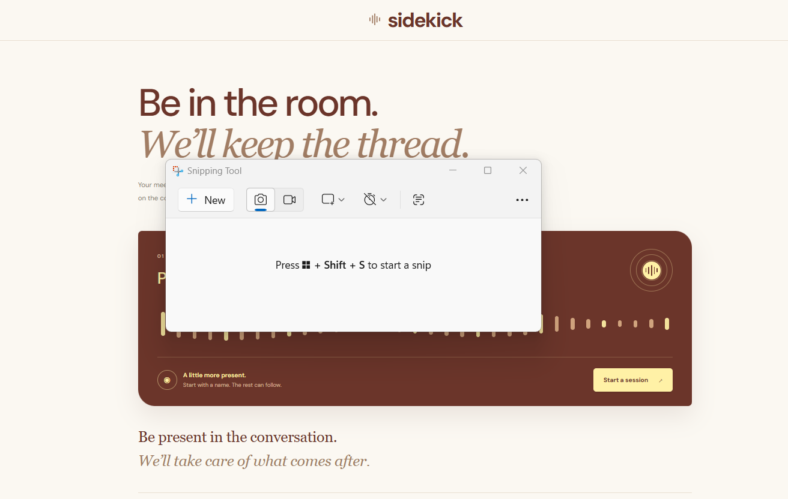

# Sidekick

A real-time meeting copilot that captures dual-stream audio, transcribes live speech, generates rolling structured notes, and enables interactive grounded Q&A.

**Live Demo:** https://sidekick-live.vercel.app

## Preview



## About

Sidekick helps you stay engaged in conversations rather than scrambling to take manual notes. It captures both meeting-tab and microphone audio directly in the browser, streams chunks over WebSockets for low-latency Groq Whisper transcription, updates rolling notes in real time, and allows you to query the meeting using a grounded AI assistant.

The idea is simple: spend less time writing things down and more time participating in the conversation.

## Features

- **Dual-Stream Audio Capture** – Captures both your microphone and shared meeting-tab audio (Google Meet, Zoom, YouTube) in the browser via `getDisplayMedia` and `getUserMedia`.
- **Real-Time Live Transcription** – Chunks audio and streams it through a FastAPI WebSocket to Groq Whisper (`whisper-large-v3-turbo`) with built-in hallucination filters.
- **Speaker Attribution & Timestamps** – Automatically tags incoming segments as `You` or `Others` alongside precise timestamps.
- **Rolling AI Live Notes** – Asynchronously distills running conversation threads into high-level summaries, key highlights, decisions, and action items as the meeting progresses.
- **Transcript-Grounded Q&A (Ask Meeting)** – Chat directly with your meeting. Answers are grounded in timestamped transcript data and cite exact moments (e.g., `[14:32:10]`).
- **Transcript Search** – Filter and search across live or historical meeting segments in real time.
- **Full Persistence** – Stores meetings, transcripts, rolling notes, personal scratchpads, and chat history in PostgreSQL (Neon).

## Built With

- **Frontend:** React, TypeScript, Vite
- **Backend:** Python, FastAPI, WebSockets, Uvicorn
- **Database:** PostgreSQL (Neon Serverless), SQLAlchemy
- **AI Models:** 
  - Audio Transcription: Groq Whisper (`whisper-large-v3-turbo`)
  - Reasoning & Summarization: Groq Llama 3.3 (`llama-3.3-70b-versatile`)
- **Audio APIs:** Web Audio API (`MediaRecorder`, `AudioContext`, `getDisplayMedia`)

## How It Works

1. **Create or Open a Session:** Start a new meeting or load an existing conversation from your workspace.
2. **Start Audio Capture:** Select the browser tab where your meeting is running (with "Share audio" checked) and allow microphone access.
3. **Stream & Transcribe:** Audio chunks are sent across a bidirectional WebSocket to the FastAPI backend, where Groq Whisper returns formatted text segments.
4. **Follow Live AI Notes:** Every few segments, background workers synthesize running highlights, decisions, and action items.
5. **Ask Questions:** Use the "Ask Meeting" tab to query specific details, quotes, or deadlines from the meeting history.
6. **Revisit Past Takeaways:** Switch to the Takeaways tab at any point to view or generate an executive recap.

## Running Locally

Clone the repository:

```bash
git clone [https://github.com/Viinuthaa/sidekick.git](https://github.com/Viinuthaa/sidekick.git)
cd sidekick

Install frontend dependencies:

```bash
npm install
```

Set up the backend:

```bash
cd backend
python -m venv .venv
```

Activate the environment on Windows:

```powershell
.venv\Scripts\Activate.ps1
```

Install dependencies:

```bash
pip install -r requirements.txt
```

Create a `.env` file inside `backend/`:

```env
DATABASE_URL=your_neon_postgresql_url
GROQ_API_KEY=your_groq_api_key
GROQ_MODEL=llama-3.3-70b-versatile
GROQ_TRANSCRIPTION_MODEL=whisper-large-v3-turbo
FRONTEND_URL=http://localhost:5173
```

Start the backend:

```bash
uvicorn main:app --reload --port 8000
```

In another terminal, from the project root, start the frontend:

```bash
npm run dev
```

The frontend uses `http://127.0.0.1:8000` as its default API URL. Set `VITE_API_BASE_URL` to override it.

## Project Structure

```text
sidekick/
├── backend/
│   ├── database.py
│   ├── main.py
│   ├── models.py
│   └── requirements.txt
├── docs/
│   └── dashboard.png
├── public/
├── src/
│   ├── lib/
│   │   └── meetingAudioCapture.ts
│   ├── App.css
│   ├── App.tsx
│   └── main.tsx
├── index.html
├── package.json
└── README.md
```
